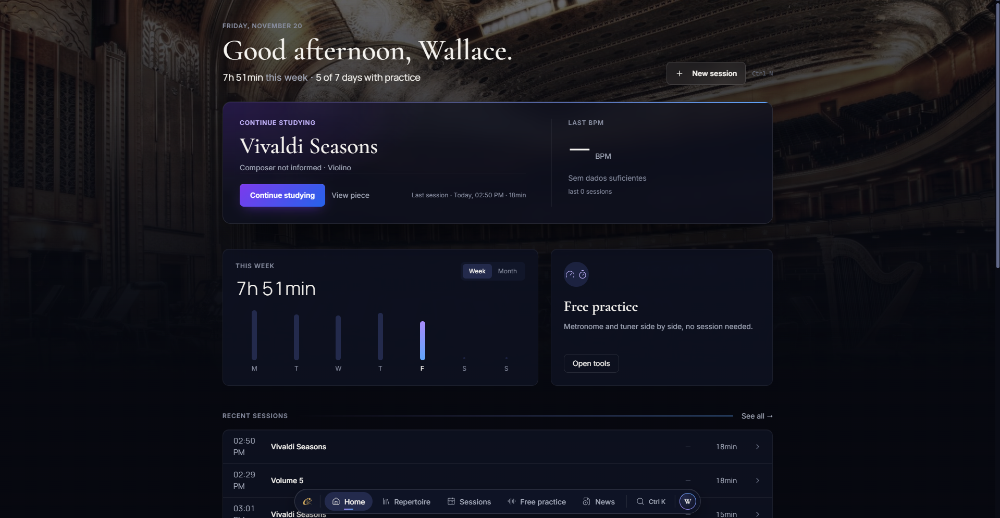
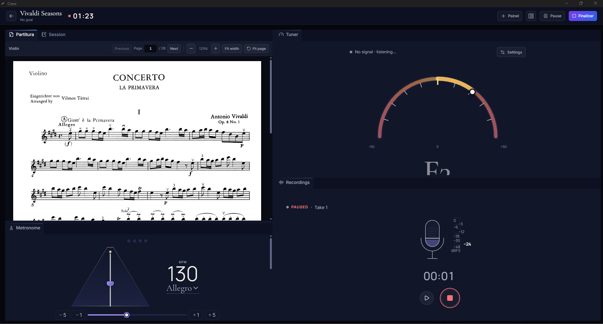
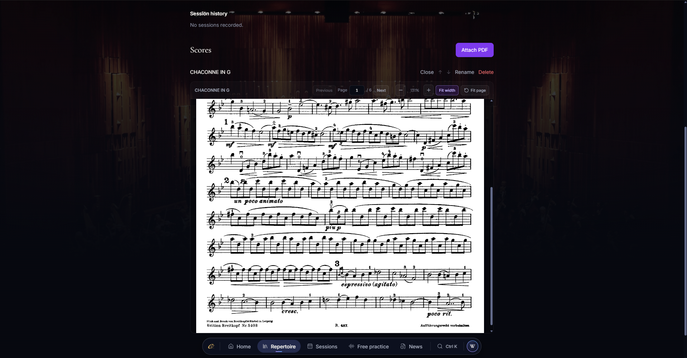
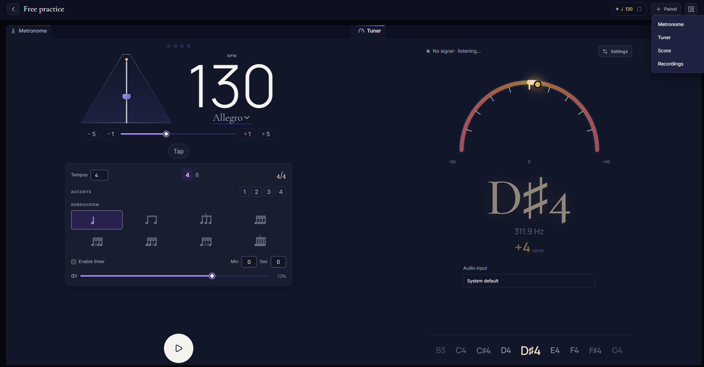
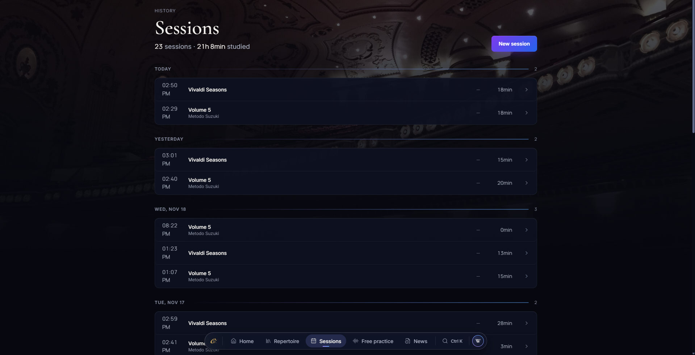

# Cress

**Leia em:** [Português](README.pt-BR.md)

Cress is a desktop app for musical practice. It brings together score viewer, metronome, tuner and recorder in one study desk, and keeps track of your progress across sessions — fully offline, with your recordings and data stored locally.

> Practice, record, understand your performance, and track your evolution.



## Features

- **Dashboard** — a daily overview of your practice: time studied this week/month, streak, last BPM per piece, and quick access to resume the piece you left off.
- **Repertoire library** — organize your pieces by composer and instrument, import folders of scores in bulk, and set study goals per piece.
- **Scores (PDF)** — view, zoom and page through a piece's score side by side with your practice tools.
- **Session Studio** — a customizable, dockable workspace (drag, resize and arrange panels) combining:
  - **Score** viewer
  - **Metronome** with BPM, accent and tap tempo
  - **Chromatic tuner** with cents deviation and configurable A4 reference
  - **Recorder** to capture takes during the session, with live level meter
- **Free practice** — open the metronome and tuner side by side instantly, no session required.
- **Session history** — every practice session is logged with duration, BPM and recordings, so you can look back and hear your progress.
- **Auto-update** — the app checks for new versions and updates itself.
- **Bilingual UI** — available in English and Portuguese (Brazil).
- **Offline-first** — no account, no telemetry; everything lives on your computer.

| Session Studio | Repertoire & Score |
| --- | --- |
|  |  |

| Free practice | Sessions |
| --- | --- |
|  |  |

## Prerequisites

- Windows 10 or 11 (native Windows is the official development environment; see ADR-04).
- Node.js 24 LTS, used for supporting tools; Bun is the main runtime and package manager.
- [Bun](https://bun.sh/).
- Rust stable 1.90 or later, with the MSVC Build Tools installed.
- WebView2 Runtime, usually included with an up-to-date Windows 10 or 11 installation.

WSL and Linux can run automated tests, but cannot run `tauri dev` or `tauri build` for the real app. Use native Windows to develop and run Cress with its audio hardware.

## Setup

From the project directory, install dependencies and start the development app:

```powershell
bun install
bun run tauri:dev
```

## Useful scripts

- `bun run check` — full local quality gate: lint, typecheck, JavaScript tests, Rust tests, and Clippy.
- `bun run lint` — lint the project.
- `bun run typecheck` — check TypeScript types.
- `bun run test` — run JavaScript/TypeScript tests.
- `bun run test:rust` — run Rust tests.

## Development app data

Development uses a separate Tauri identifier configured in `src-tauri/tauri.dev.conf.json`. This keeps the development app's SQLite database in a separate `app_data_dir` from the installed production app, preventing both from sharing the same database.
