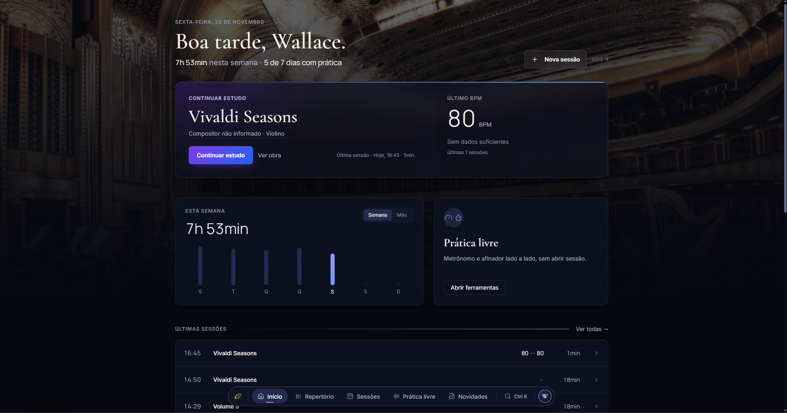
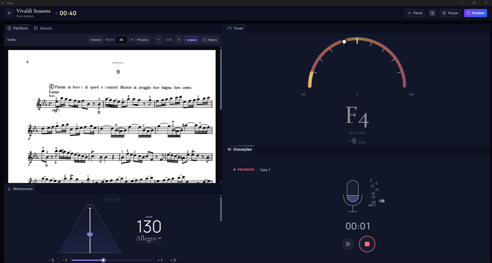
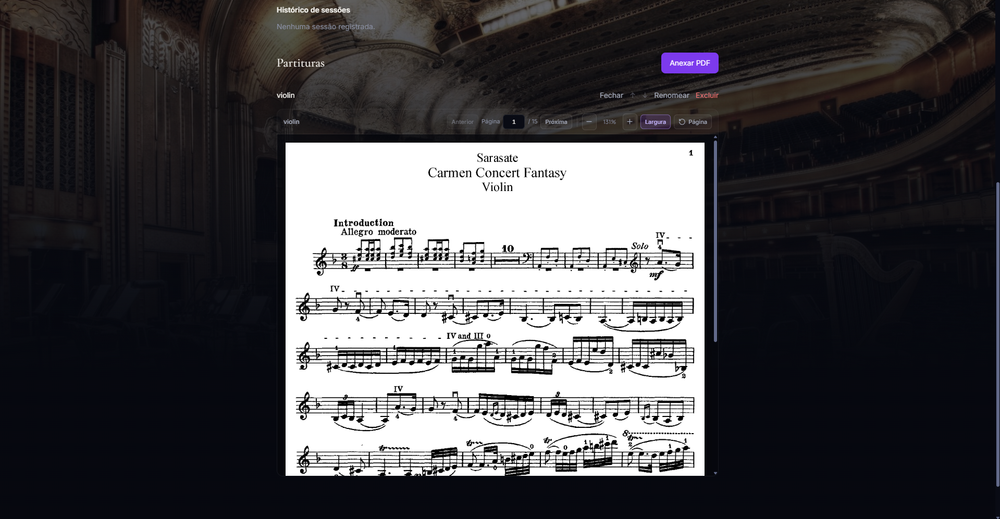
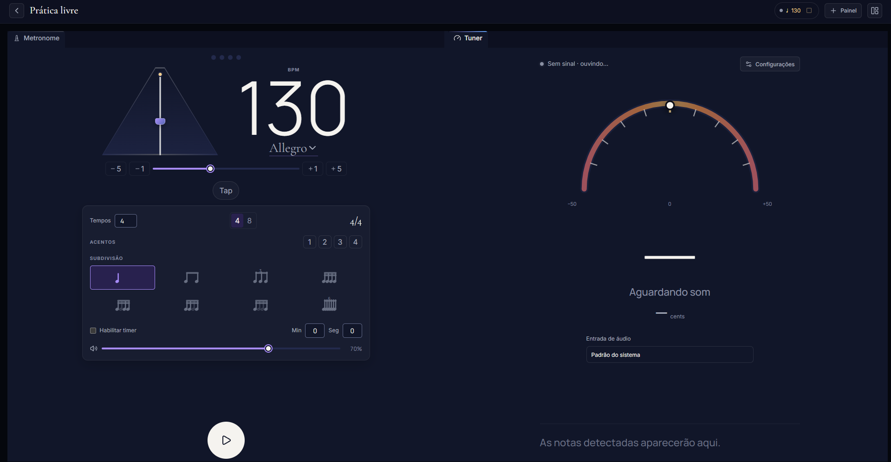
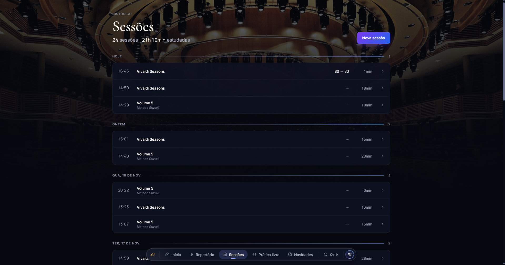

# Cress

**Read in:** [English](README.md)

Cress é um aplicativo desktop de prática musical. Ele reúne visualizador de partitura, metrônomo, afinador e gravador em um único ambiente de estudo, e acompanha sua evolução ao longo das sessões — totalmente offline, com suas gravações e dados armazenados localmente.

> Pratique, grave, entenda sua execução e acompanhe sua evolução.



## Funcionalidades

- **Início** — uma visão diária da sua prática: tempo estudado na semana/mês, sequência de dias, último BPM por obra e acesso rápido para continuar de onde parou.
- **Biblioteca de repertório** — organize suas obras por compositor e instrumento, importe pastas de partituras em lote e defina objetivos de estudo por obra.
- **Partituras (PDF)** — visualize, dê zoom e navegue pelas páginas da partitura de uma obra lado a lado com suas ferramentas de prática.
- **Sessão de Estudo** — um ambiente de trabalho personalizável e com painéis encaixáveis (arraste, redimensione e organize), combinando:
  - **Partitura**
  - **Metrônomo** com BPM, acentuação e tap tempo
  - **Afinador cromático** com desvio em cents e referência de A4 configurável
  - **Gravador** para capturar takes durante a sessão, com medidor de nível em tempo real
- **Prática livre** — abra o metrônomo e o afinador lado a lado instantaneamente, sem precisar iniciar uma sessão.
- **Histórico de sessões** — toda sessão de prática é registrada com duração, BPM e gravações, para você revisitar e ouvir sua evolução.
- **Atualização automática** — o app verifica novas versões e se atualiza sozinho.
- **Interface bilíngue** — disponível em português (Brasil) e inglês.
- **Offline-first** — sem conta, sem telemetria; tudo fica no seu computador.

| Sessão de Estudo | Repertório e Partitura |
| --- | --- |
|  |  |

| Prática livre | Sessões |
| --- | --- |
|  |  |

## Pré-requisitos

- Windows 10 ou 11 (o Windows nativo é o ambiente oficial de desenvolvimento; ver ADR-04).
- Node.js 24 LTS, usado para ferramentas de suporte; o Bun é o runtime e gerenciador de pacotes principal.
- [Bun](https://bun.sh/).
- Rust stable 1.90 ou mais recente, com o MSVC Build Tools instalado.
- WebView2 Runtime, normalmente incluído em uma instalação atualizada do Windows 10 ou 11.

WSL e Linux conseguem rodar os testes automatizados, mas não conseguem rodar `tauri dev` ou `tauri build` para o app real. Use o Windows nativo para desenvolver e rodar o Cress com seu hardware de áudio.

## Configuração

A partir do diretório do projeto, instale as dependências e inicie o app de desenvolvimento:

```powershell
bun install
bun run tauri:dev
```

## Scripts úteis

- `bun run check` — gate de qualidade local completo: lint, typecheck, testes JavaScript, testes Rust e Clippy.
- `bun run lint` — lint do projeto.
- `bun run typecheck` — verifica os tipos do TypeScript.
- `bun run test` — roda os testes JavaScript/TypeScript.
- `bun run test:rust` — roda os testes Rust.

## Dados do app em desenvolvimento

O desenvolvimento usa um identificador Tauri separado, configurado em `src-tauri/tauri.dev.conf.json`. Isso mantém o banco de dados SQLite do app de desenvolvimento em um `app_data_dir` separado do app de produção instalado, evitando que os dois compartilhem o mesmo banco.
